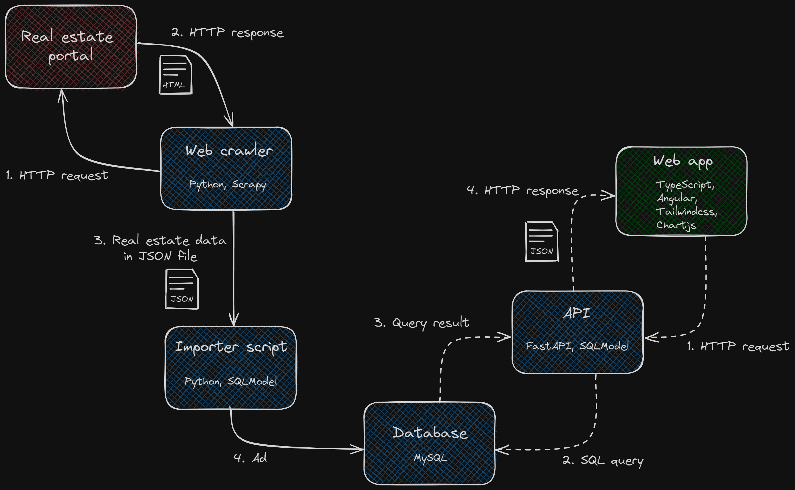

# Nepremicnine sledilnik

> [!NOTE]
>This branch preserves the original application before redevelopment. Automatic
>data collection stopped working because the source website blocks the scraper,
>and other known bugs remain.
>
>This version is retained for historical reference. Further development continues
>on `master`.

A price tracker and analytics app for the Slovenian real estate market.

We monitor the leading real estate portal in Slovenia for you. Then we provide ad history and other analytics tools, so you can deepen your understanding of the real estate market, asses your offer, and make well-informed, important decisions.

Try the MVP version at [nepremicninesledilnik.com](http://www.nepremicninesledilnik.com/search)

## Motivation

As you probably know, buying real estate today in Slovenia is quite challenging due to the housing crisis.
The lack of apartments is causing, or better, allowing available apartments on the market to reach record prices.

This got me thinking. How does someone with no experience start searching for a (first) home? How can someone evaluate if the real estate price is appropriate or fair? How to assess an offer?

I concluded that the best way is to start monitoring the real estate market and track prices on ads that are interesting to us. However, doing that manually is time-consuming and inefficient.

The existing real estate portals and analyzing tools kind of suck. The real estate portals have outdated UIs or are not transparent enough (they don't show price history and the date when the ad was published, etc.). The analyzing tools are targeted at real estate professionals and cost a boatload of money.

So I build this. My own price tracking and analyzing tool for the Slovenian real estate market. To justify the dozens of hours spent, I turned it into a [bachelor thesis.](https://dk.um.si/IzpisGradiva.php?id=88433&lang=slv)

## How does it work?

TLDR. The crawler scrapes daily the leading real estate portal in Slovenia. At the end of the job, it outputs a JSON file with the most up-to-date real estate ad data. The importer script takes care of this JSON file. It imports new and updates existing ads in the database. Thus, the ads are organized and safely stored, ready for viewing.

The viewing is done with the web app. When the user visits our app, an API call is triggered, which performs some SQL queries and returns relevant data to the web app. The web app then displays this data in a user-friendly way, using visualizations and other graphics. The described process is shown in the diagram below, which includes technologies used to build every component.

### Tech stack

- Backend made with Python
  - Scrapy for web crawler
  - FastAPI for processing requests from the web app
  - SQLModel for unified data models and querying the db within Python code
  - MySQL for database
- Frontend made with TypeScript
  - Angular for the web app
  - TailwindCSS for easy styling
  - Chartjs for ploting the charts
- DevOps
  - Docker for easy deployment. All services run in Docker containers.
  - GitHub Actions for automatically building Docker images and pushing them to the registry
  - Bash scripts and cron jobs.

Still curious? A more detailed description of how it works is available in my [bachelor thesis.](https://dk.um.si/IzpisGradiva.php?id=88433&lang=slv)

## Roadmap

What am I planning to do next?

- [ ] Add SSL certificate with Traefik
- [ ] Add Plausible analytics
- [ ] Fix known bugs
- [ ] Add unit tests for API
- [ ] Add unit tests for frontend
- [ ] Refactor analytics feature
- [ ] Improve UI - responsive design
- [ ] Further improve app functionality - I have so many exciting ideas :)

## Feedback

Thanks for taking the time to look at my project. The app is far from perfect, but it is a start - MVP. I would appreciate your feedback, bug reports, or feature requests. I am always open to talk about it!
